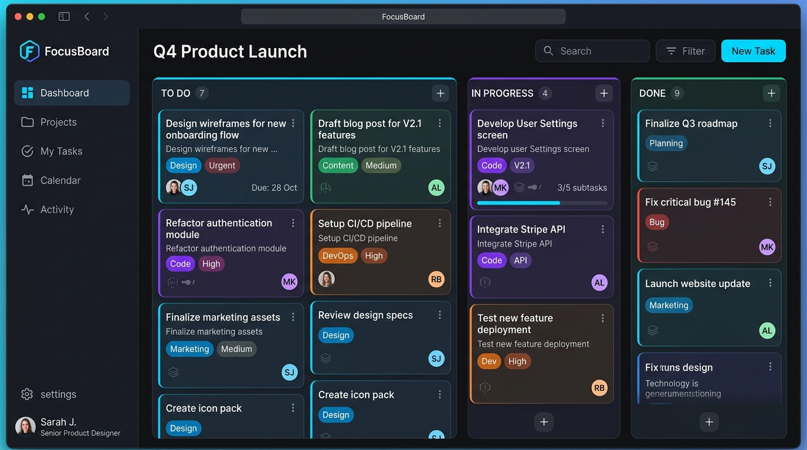
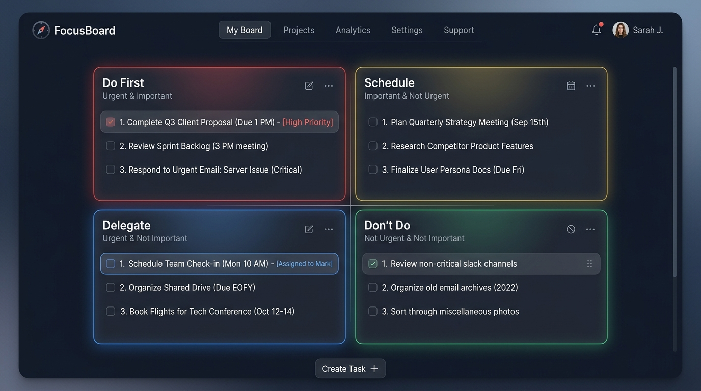
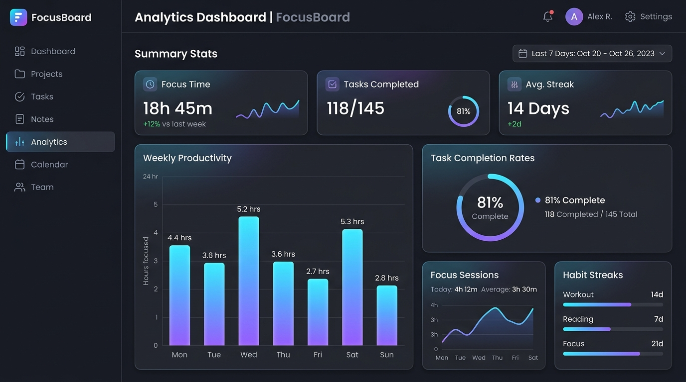
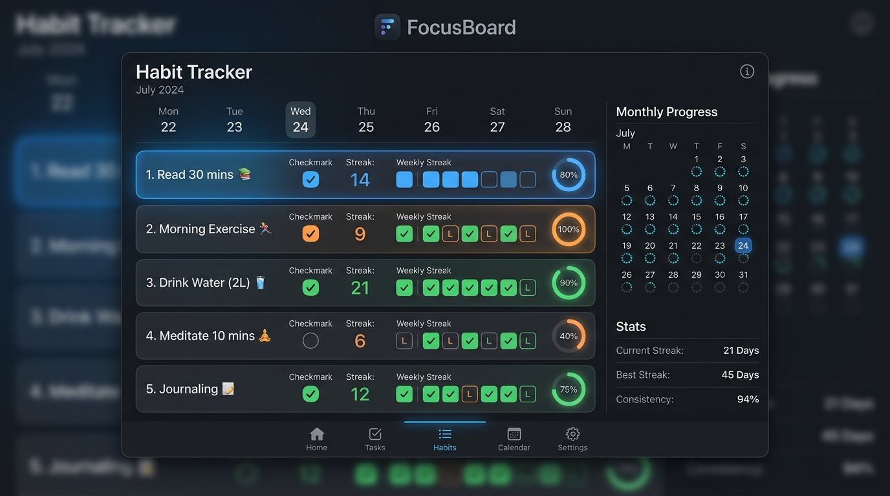

<h1 align="center">FocusBoard</h1>

<p align="center">
  <strong>A productivity app combining Kanban boards and the Eisenhower Matrix.</strong>
  <br/>
  <a href="https://flutter.dev" target="_blank"></a>
  <a href="https://dart.dev" target="_blank"></a>
  <a href="LICENSE"></a>
</p>

---

## ✨ Features

| Feature | Description |
|---|---|
| **📋 Kanban Board** | Drag-and-drop task management with swimlanes (To Do, In Progress, Done). |
| **📊 Eisenhower Matrix** | Prioritise tasks by urgency and importance (Eisenhower method). |
| **📈 Analytics** | Visual insights into your productivity trends and task completion. |
| **✅ Habit Tracker** | Track daily habits and build consistent routines. |
| **🌙 Dark / Light Theme** | Full theme support — light, dark, and customisable accent colours. |
| **🌍 Localisation** | Built with `intl` — ready for multiple languages. |

## 📸 Screenshots

| Kanban Board | Eisenhower Matrix |
|---|---|
|  |  |
| **Analytics Dashboard** | **Habit Tracker** |
|  |  |

## 🚀 Getting Started

### Prerequisites

- [Flutter](https://flutter.dev/docs/get-started/install) 3.5+
- [Dart](https://dart.dev/get-dart) 3.5+

### Installation

```bash
# Clone the repository
git clone https://github.com/shipblueprint/FocusBoard.git
cd FocusBoard/app

# Install dependencies
flutter pub get

# Run the app
flutter run
```

### Build

```bash
# Android
flutter build apk --debug
flutter build apk --release
flutter build appbundle --release   # Play Store

# iOS (macOS only)
flutter build ios --release

# Windows
flutter build windows --release

# Linux
flutter build linux --release
```

## 📦 Download & Install

### Windows

Pre-built Windows releases are available on the [Releases page](https://github.com/shipblueprint/FocusBoard/releases).

Download the latest `FocusBoard-windows-x64.zip`, extract it anywhere, and run `FocusBoard.exe`.

> **No installation required** — just unzip and run. The app is fully self-contained.

**To build from source:**
```bash
flutter build windows --release
# Output: build/windows/x64/runner/Release/
```

### Linux

Download the latest `FocusBoard-linux-x64.tar.gz` from the [Releases page](https://github.com/shipblueprint/FocusBoard/releases), extract it, and run the `FocusBoard` binary inside:

```bash
tar xzf FocusBoard-linux-x64.tar.gz
./FocusBoard/FocusBoard
```

> **No installation required** — the bundle is self-contained, but it does use the system GTK 3 libraries (`libgtk-3.so.0`), which are already present on any desktop Linux distribution. Requires glibc 2.34 or newer (Ubuntu 22.04+, Debian 12+, Fedora 36+).

**To build from source:**
```bash
flutter build linux --release
# Output: build/linux/x64/release/bundle/
```

**Installing it on the build host (per-user, no root).** Every release install goes through
one script — it builds nothing itself, so run `flutter build linux --release` (or the
`--debug` variant) first:

```bash
scripts/install-linux.sh            # release bundle -> ~/.local/share/focusboard
scripts/install-linux.sh --debug    # install the debug bundle instead
scripts/install-linux.sh --launch   # ...and start it afterwards
```

It stops any running instance, `rsync --delete`s the bundle into
`~/.local/share/focusboard/`, (re)writes
`~/.local/share/applications/io.github.shipblueprint.focusboard.desktop` — whose `Exec=` line
is the authoritative path — regenerates the hicolor icon sizes from `focusboard_icon.png`,
validates the desktop file, refreshes the mime/icon caches, and prints the installed
`libapp.so` timestamp so you can confirm the new code landed.

> It refuses to install a bundle whose `libapp.so` is older than `lib/`. Dart-only edits do
> not relink the runner, so `FocusBoard` itself keeps an old timestamp — always check
> `lib/libapp.so`, never the executable.

A Linux build needs a C/C++ toolchain plus the GTK 3 development headers, and the
desktop target enabled once per machine:

```bash
# Fedora / RPM-based
sudo dnf5 install -y clang cmake ninja-build gtk3-devel

# Ubuntu / Debian-based
sudo apt install clang cmake ninja-build pkg-config libgtk-3-dev

flutter config --enable-linux-desktop
flutter doctor   # "Linux toolchain" must be green
```

> **Gotchas**
> * The package is `ninja-build`, not `ninja`.
> * `glu-devel` is not available on recent Fedora (Mesa GLU was retired) and is not needed.
> * Flutter is not packaged for Fedora — install it from the [official tarball](https://docs.flutter.dev/get-started/install/linux). It bundles Dart, so do not install Dart separately.
> * `webkit2gtk` is only required if a webview plugin is added; this app has no Linux-native plugins.
> * On the current dev machine `gtk3-devel` is not installed system-wide, so builds run through `/mnt/data/gtkdev/flutter-linux-build.sh`, which points `PKG_CONFIG_PATH` at an unprivileged header prefix. Both become unnecessary once the package above is installed.


## 🧰 Tech Stack

| Tool | Purpose |
|---|---|
| [Flutter](https://flutter.dev) | Cross-platform UI framework |
| [Get](https://pub.dev/packages/get) | State management, routing, DI |
| [SharedPreferences](https://pub.dev/packages/shared_preferences) | Local persistence |
| [Google Fonts](https://pub.dev/packages/google_fonts) | Typography |
| [flutter_lucide](https://pub.dev/packages/flutter_lucide) | Premium icon set |
| [intl](https://pub.dev/packages/intl) | Internationalisation |
| [url_strategy](https://pub.dev/packages/url_strategy) | Web URL handling |

## Platforms

| Platform | Status |
|---|---|
| 📱 Android | ✅ Supported |
| 🍎 iOS | ✅ Supported (macOS build required) |
| 🪟 Windows | ✅ Supported (x86‑64) |
| 🐧 Linux | ✅ Supported (x86‑64) |
| 🌐 Web | ⏳ Experimental |

## 📦 Releasing

1. **Bump the version** in `pubspec.yaml`. The `version:` field is what the running app
   reports and it is independent of the git tag — keep the two in step
   (`version: 1.0.1+2` pairs with tag `v1.0.1`).
2. **Build each platform from the commit you intend to publish**, so the tag and the
   binaries describe the same code.
3. **Package** one archive per platform, named `FocusBoard-<platform>-<arch>.zip|tar.gz`.
   The Linux `bundle/` directory *is* the release:

   ```bash
   cd build/linux/x64/release
   # re-root to FocusBoard/ so extraction does not create a folder named "bundle"
   tar czf ../../../FocusBoard-linux-x64.tar.gz --transform 's,^bundle,FocusBoard,' bundle
   ```

4. **Publish**, targeting the exact commit the artifact was built from:

   ```bash
   gh release create v1.0.1 --target "$(git rev-parse HEAD)" \
     --title "v1.0.1 — Linux (x86-64)" --notes-file notes.md \
     FocusBoard-linux-x64.tar.gz
   ```

   `--target` needs a **full** commit SHA; an abbreviated one fails with
   `Release.target_commitish is invalid`. To add an asset to an existing release, use
   `gh release upload <tag> <file>`.
5. **Confirm the asset serves** — `curl -sIL <download-url> | head -1` should return 200.

> **Conventions**
> * Each platform currently lives on its own release (`v1.0.0` = Windows, `v1.0.1` = Linux)
>   so every tag matches the source its binary was built from. GitHub marks the newest
>   release *Latest*, so link the other platforms from each release's notes.
> * `focusboard_icon.png` in the repo root is the single source of truth for the icon.
>   Windows consumes a derived `windows/runner/resources/app_icon.ico` — regenerate it
>   when the icon changes. Linux installs the PNG itself into `data/icons/` and loads it
>   at runtime, so it needs no conversion step.
> * `android/`, `ios/` and `macos/` still carry the template identifier
>   `com.example.henox`. Changing `applicationId` / `PRODUCT_BUNDLE_IDENTIFIER` changes
>   install identity and stops existing users from receiving updates — treat it as a
>   planned migration, not a rename.

## 🤝 Contributing

Contributions are welcome! Please open an issue or submit a pull request.

1. Fork the project
2. Create your feature branch (`git checkout -b feature/amazing-feature`)
3. Commit your changes (`git commit -m 'Add amazing feature'`)
4. Push to the branch (`git push origin feature/amazing-feature`)
5. Open a Pull Request

## 📄 License

Distributed under the MIT License. See `LICENSE` for more information.

---

<div align="center">
  <sub>Built with ❤️ by <a href="https://github.com/shipblueprint">shipblueprint</a></sub>
</div>
